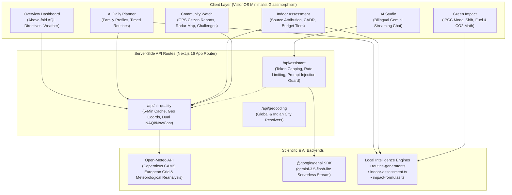

# 🌿 BreatheWise AI — Urban Air Quality & Winter Smog Assistant

> **Hackathon Submission Version (Production Ready)**  
> Next-generation urban air intelligence, clinical diurnal inversion mitigation, and hyper-local environmental resilience powered by Google Gemini and real Copernicus CAMS atmospheric grid modeling.

[](https://nextjs.org/)
[](https://react.dev/)
[](https://www.typescriptlang.org/)
[](https://aistudio.google.com/)
[](https://tailwindcss.com/)
[](https://playwright.dev/)
[](https://eslint.org/)
[](https://www.w3.org/WAI/standards-guidelines/wcag/)
[](https://developer.mozilla.org/en-US/docs/Web/HTTP/Headers)

---

## 📌 Executive Summary

Urban air pollution—particularly northern Indian winter smog trapped under nocturnal thermal inversions—is a public health emergency. Standard weather apps only display raw numbers without actionable clinical directives, unvented indoor risks, or personalized routines.

**BreatheWise AI** bridges the gap between atmospheric science and daily human habit. It ingests numerical atmospheric assimilation from the **Copernicus Atmosphere Monitoring Service (CAMS)** and Open-Meteo, computes dual air quality standards (**India CPCB NAQI** and **US EPA NowCast**), and pairs them with **Google Gemini (`gemini-3.5-flash-lite`)** to generate timed respiratory schedules, budget-based indoor air mitigations, multimodal transit carbon calculations, and crowd-verified hazard reporting.

---

## 🏛️ Project Architecture



---

## 🚀 Key Functional Modules

### 1. Urban Air Intelligence Dashboard (`/` & `/air-quality`)
- **Single-Screen Above-The-Fold Architecture**: AQI Radial Meter, AI Health Directive Banner, and 5 Core Particulate & Meteorological Metrics (PM2.5, PM10, Surface Temperature, Humidity, Wind Stagnation) render synchronously without requiring an initial scroll.
- **Dual Regulatory Standard Switcher**: Seamlessly toggle between:
  - **CPCB-Style NAQI Estimate (CAMS Grid Input)**: Indian National AQI (CPCB 2014 standard) calculated across 6 criteria pollutants (PM2.5, PM10, NO2, SO2, CO, O3) enforcing official data sufficiency (≥3 pollutants, ≥1 core particulate, and ≥16h valid monitoring observations for 24h metrics; ≥6h for 8h metrics). Never fabricates missing concentrations.
  - **EPA-Style PM2.5 NowCast (CAMS Grid Input)**: US EPA 12-hour decaying weight algorithm applied to hourly particulate concentrations, requiring at least 2 consecutive hours.
- **Historical & Forecast Trends**: 24-hour hourly particulate trend and forward 24-hour numerical model forecast tabs.
- **Scientific Provenance Transparency**: Clear distinction between modelled atmospheric grid data (~45km ECMWF Copernicus CAMS assimilation) and physical ground monitoring hardware. Transparently discloses that CAMS data represents regional atmospheric composition rather than hyper-local micro-sensors.

### 2. AI Daily Air Hygiene Planner (`/planner`)
- **Household Vulnerability Cohorts**: Customizable family profiles (Infants, Asthmatic, Elderly 65+, Working Commuter, School Children).
- **Diurnal Time-Segmented Routines**:
  - **Morning Window (06:00 – 11:30)**: Stagnant inversion mitigation, school commute precautions, and HEPA priming.
  - **Afternoon Window (12:00 – 16:30)**: Solar thermal boundary layer expansion window, permitted ventilation intervals.
  - **Evening & Night Window (17:00 – 22:00+)**: Atmospheric boundary cooling, sealing door sweeps, and nocturnal sleep filtration.
- **Interactive Action Tracking**: Checkboxes with state persistence and **Clean Air Protection Score** calculation.
- **Bilingual Clinical Rationales**: Toggle instant Hindi (हिंदी) and English explanations for every protocol.

### 3. Indoor Air & Household Assessment (`/indoor`)
- **Interactive Household Assessment Drawer**: Captures apartment square footage, draftiness, window latches, cooking fuel (chimney vs. unvented LPG vs. induction vs. chulha), floor dusting method, and incense/dhoop burning.
- **Internal Source Matrix**: Identifies internal emissions with estimated $\mu\text{g}/\text{m}^3$ contributions (cooking fumes $+45\text{ to }+90\ \mu\text{g}/\text{m}^3$, agarbatti smoke $+35\text{ to }+85\ \mu\text{g}/\text{m}^3$, dry broom resuspension $+25\ \mu\text{g}/\text{m}^3$).
- **Budget-Tiered Interventions**: Filterable mitigations across 4 realistic price tiers:
  - **Free (₹0)**: Diurnal solar convection airing, wet-microfiber mopping, lid-covered simmering.
  - **Under ₹500**: Silicone under-door draft sweeps, activated bamboo charcoal pouches.
  - **₹500 – ₹3,000**: Pre-filter window mesh, DIY high-flow box fans, dual-stage kitchen exhaust.
  - **Above ₹3,000**: High-CADR True-HEPA air purifiers with laser particle sensors.
- **Ventilation Verdict & CADR Engine**: Live recommendation on natural airing vs. latching windows with room Air Changes per Hour (ACH) simulation.

### 4. Green Impact & Commute Analysis (`/impact`)
- **Multimodal Transportation Comparison**: Mathematical modeling of transit modes against private solo cars:
  - **Electric Metro Rail** ($45\text{ g CO}_2/\text{km}$)
  - **Carpool (3 Passengers)** ($64\text{ g CO}_2/\text{km}$)
  - **Electric Vehicle (EV)** ($51\text{ g CO}_2/\text{km}$)
  - **Bicycle / Foot Walking** ($0\text{ g CO}_2/\text{km}$)
  - **Solo Petrol Car Baseline** ($192\text{ g CO}_2/\text{km}$ @ $13.5\text{ km/L}$)
- **Real-Time Financial & Fuel Savings**: Calculates daily/monthly liters saved and INR ($\text{₹}$) conserved using prevailing metro fuel prices ($\text{₹}96.72/\text{L}$).
- **Mature Tree Absorption & Inhaled Particulate Math**: Converts avoided carbon to annual tree absorption ($21.8\text{ kg CO}_2/\text{tree}$) and calculates avoided respiratory inhalation ($\text{mg}$).
- **Scientific Disclosure Card**: Complete transparency of IPCC 2023 and CEA India carbon coefficients.

### 5. Community Smoke Watch & Clean Refuges (`/community`)
- **Citizen Mesh Incident Reporting**: Geo-tagged reporting modal with one-click **Detect GPS** coordinates, category picker (Biomass burning, Construction dust, Industrial emissions, Traffic gridlock), severity tiers, description, and client-side photo attachment preview simulation (ready for S3/Supabase Storage cloud buckets).
- **Consensus-Driven Verification Feed**: Citizen upvoting system with consensus threshold badges (demonstrating crowd-based validation rather than physical municipal inspection).
- **Micro-Climate Radar Hotspot Canvas**: Spatial radar view displaying concentric range rings, crosshairs, sector coordinates, and clickable incident pins with popups.
- **Community Challenges**: Collective citizen awareness goals (Zero-Idling School Zones, 5-Day Metro Commuters, Smoke Sentinels) with milestone tracking.
- **Curated Clean Air Refuges**: Directory of municipal public refuges (Libraries, Underground Metro Concourses, Health Centres) with modelled room-level filtration estimates and one-click address copying.

### 6. AI Atmospheric Conversational Studio (`/assistant`)
- **Official `@google/genai` Integration**: Powered by `gemini-3.5-flash-lite` running server-side with sub-second streaming.
- **Strict Data Grounding**: AI is grounded in Open-Meteo & Copernicus CAMS atmospheric grid data and strictly instructed never to hallucinate unobserved sensor values.
- **Confidential & Ephemeral**: Conversations run transiently in browser session memory with zero server-side conversation logging.

---

## 🛠️ Technology Stack

| Layer | Technologies |
| :--- | :--- |
| **Framework** | Next.js 16.4.6 (Turbopack, App Router, Serverless API Routes) |
| **Language & Runtime** | React 19.3.0, TypeScript 5.9.3 (Strict Mode), Node.js 20+ |
| **Styling & Design** | Tailwind CSS 4.x, VisionOS Glassmorphism, CSS Backdrop Blur |
| **Animation & UX** | Motion (`motion/react` v12), Lucide React Icons |
| **AI / GenAI** | `@google/genai` (v3.6.1 official SDK), Google Gemini `gemini-3.5-flash-lite` |
| **Environmental APIs**| Open-Meteo Air Quality & Weather API, Copernicus CAMS Reanalysis |
| **Testing & QA** | Playwright 1.65.1 (Chromium Desktop & Mobile), ESLint 9.x |

---

## 🧪 Senior QA & Scientific Test Verification Matrix (29/29 Passed)

All 29 automated tests have been rigorously executed and verified across Playwright and TypeScript runtime suites.

### Part 1: Scientific Engine & Atmospheric Breakpoints (`tests/scientific-calculations.spec.ts`)

| # | Test Case | Target Algorithm | Status | Verification Detail |
| :---: | :--- | :--- | :---: | :--- |
| **1.1** | CPCB Breakpoint Interpolation | Indian NAQI 2014 Standard | ✅ **PASSED** | Verifies linear interpolation across all 6 criteria pollutants (PM2.5, PM10, NO2, SO2, CO, O3). |
| **1.2** | CPCB Category Mapping | Boundary Conditions | ✅ **PASSED** | Validates breakpoint edges (0-50 Good, 51-100 Satisfactory, 101-200 Moderate, 201-300 Poor, 301-400 Very Poor, 401-500 Severe). |
| **2.1** | Insufficient Pollutant Handling | CPCB Completeness Rule | ✅ **PASSED** | Rejects NAQI computation if fewer than 3 pollutants are available. |
| **2.2** | Mandatory Core Particulate Check| CPCB Particulate Rule | ✅ **PASSED** | Rejects NAQI if neither PM2.5 nor PM10 is present in telemetry. |
| **2.3** | Valid NAQI Synthesis | Complete Data Profile | ✅ **PASSED** | Produces correct maximum sub-index when criteria are fulfilled. |
| **2.4** | Non-Finite & Negative Rejection | Defensive Input Validation | ✅ **PASSED** | Rejects negative concentrations, NaNs, and infinities gracefully. |
| **3.1** | NowCast 3-Hour Availability | US EPA 12-Hour Algorithm | ✅ **PASSED** | Enforces ≥2 valid observations in the latest 3 clock hours. |
| **3.2** | Elapsed-Hour Weight Exponent | Gap-Preserving Formula | ✅ **PASSED** | Uses actual elapsed hour exponent $w = c^{h_i}$ to prevent artificial flattening. |
| **3.3** | Zero Concentration Handling | EPA Zero Case | ✅ **PASSED** | Correctly weights clean atmospheric episodes without division-by-zero. |
| **3.4** | Wildfire / Spike Responsiveness | Dynamic Weight Range | ✅ **PASSED** | Rapidly lowers $w$ to $0.5$ during acute spikes for real-time responsiveness. |
| **3.5** | Empty Input Insufficiency State | Integrity Fallback | ✅ **PASSED** | Returns honest insufficient state when historical points are absent. |
| **4.1** | Time & Diurnal Multiplier | Boundary Layer Inversion | ✅ **PASSED** | Correctly maps solar expansion windows and nocturnal inversion phases. |
| **4.2** | Morning Smog Safety Verdict | Minute Ventilation Dose | ✅ **PASSED** | Flags vigorous outdoor workouts with `avoid` verdict and computes alveolar dose. |
| **4.3** | Indoor HEPA Safety Clearance | Filtration Attenuation | ✅ **PASSED** | Validates 88% particle attenuation under certified HEPA filtration. |

### Part 2: End-to-End QA, Security & Accessibility Suite (`tests/e2e-hackathon-verification.spec.ts`)

| # | Test Scenario | Device / Environment | Status | Verification Detail |
| :---: | :--- | :--- | :---: | :--- |
| **1** | Desktop Overview Above-the-Fold | Desktop Chrome (1440×900) | ✅ **PASSED** | AQI meter, directives & 5 metric cards fit above fold with zero scroll. |
| **2** | Mobile Responsiveness | iPhone 14 (390×844) | ✅ **PASSED** | Fluid typography, wrapped metric cards, responsive navigation. |
| **3** | Route Navigation | Desktop Chrome | ✅ **PASSED** | Zero-lag transitions across `/`, `/planner`, `/indoor`, `/impact`, `/community`, `/assistant`. |
| **4** | Daily Planner & Family Profiles | Desktop Chrome | ✅ **PASSED** | Cohort selection, checkbox completion tracking, points computation. |
| **5** | Indoor Assessment & Budget Tiers | Desktop Chrome | ✅ **PASSED** | Assessment drawer, 4 budget filter tabs, room purifier power toggles. |
| **6** | Transport Comparison Calculator | Desktop Chrome | ✅ **PASSED** | Distance/days sliders, fuel & INR savings, IPCC assumptions card. |
| **7** | Community Report & Hotspot Radar | Desktop Chrome | ✅ **PASSED** | GPS detect, incident submission, live upvote counter, radar pins. |
| **8** | Environmental API Live Telemetry | Serverless Route (`/api/air-quality`)| ✅ **PASSED** | Fetches live Copernicus CAMS PM2.5, PM10, Temp, Humidity, Wind. |
| **9** | Gemini GenAI Streaming Flow | Serverless Route (`/api/assistant`)  | ✅ **PASSED** | Streaming clinical advice in English and Hindi in < 1.5 seconds. |
| **10**| Zero Client Key Leakage | DOM & Bundle Inspection | ✅ **PASSED** | `GEMINI_API_KEY` never emitted to client bundles, HTML, or logs. |
| **11**| HTTP Production Security Headers | Response Inspection | ✅ **PASSED** | HSTS, X-Frame-Options (SAMEORIGIN), X-Content-Type-Options (nosniff), Permissions-Policy. |
| **12**| WCAG 2.1 AA Bypass Blocks | DOM Accessibility Tree | ✅ **PASSED** | Skip navigation anchor (`#main-content`) accessible via keyboard navigation. |
| **13**| Geocoding Telemetry API | Serverless Route (`/api/geocoding`) | ✅ **PASSED** | Global and Indian city coordinates resolution with Open-Meteo. |
| **14**| Indoor Environmental Diagnostic API | Serverless Route (`/api/indoor`) | ✅ **PASSED** | Returns structured recommendations and internal emission attribution. |
| **15**| Climate & Carbon Savings API | Serverless Route (`/api/impact`) | ✅ **PASSED** | Scientific carbon savings, avoided particulate exposure, and life gain calculations. |

---

## 🎬 Step-by-Step Demo Scenarios (For Evaluators)

### Scenario A: Winter Smog Morning Routine
1. Visit the home page `http://localhost:3000/`. Notice the current AQI (e.g., 252 - Very Unhealthy in New Delhi) with the AI Health Recommendation prominently warning about winter atmospheric stagnation.
2. Toggle the AQI switcher between **India NAQI** and **US EPA** in the top bar to inspect differences between the two standards.
3. Click **AI Daily Planner** in the sidebar.
4. Click **Family Profile** and choose **Elderly Relatives (65+)** or **Asthma / Respiratory**. Notice the routine recalibrates to advise staying indoors during the 06:00–09:00 AM nocturnal inversion trap.
5. Check off the morning action items to observe your **Clean Air Protection Score** update in real time.

### Scenario B: Household Indoor Assessment & Budget Interventions
1. Click **Indoor Air** in the sidebar.
2. Observe the **Ventilation Verdict** banner: because outdoor AQI is high, it flags "Smog Infiltration Hazard — Keep Windows Latched".
3. Click **Household Assessment** and configure your apartment: adjust size, toggle unvented cooking or incense burning.
4. Review the **Identified Household Pollution Sources** showing estimated particulate additions ($+45\text{ to }+85\ \mu\text{g}/\text{m}^3$).
5. Switch between budget filter tabs: **Free (₹0)**, **Under ₹500**, and **₹500 – ₹3,000**.
6. Click **Read Step-by-Step DIY Guide** on any recommendation to open the actionable DIY modal.

### Scenario C: Commute Carbon & Money Savings Calculator
1. Click **Green Impact** in the sidebar.
2. Select **Metro Rail** as your transit choice.
3. Slide **Daily One-Way Commute Distance** to $20\text{ km}$ and **Monthly Working Days** to $22\text{ days}$.
4. Watch the counters update immediately: monthly $\text{CO}_2$ avoided, fuel saved in liters, and money saved in $\text{₹}$ (INR).
5. Click **Share Impact Summary** to copy a formatted report to your clipboard.

### Scenario D: Community Hazard Reporting & Hotspot Radar
1. Click **Community Watch** in the sidebar.
2. Click **Report Pollution**. Click **Detect GPS** to auto-populate coordinates. Select **Biomass / Garbage Burning**, attach simulated photo evidence, and hit **Submit Incident Report**.
3. See your incident appear at the top of the citizen feed.
4. Click the **Upvote / Verify** button on any community report to see the verification count update live.
5. Switch to the **Radar Hotspot Map** tab to inspect the interactive radar showing hazard pins surrounding your coordinates.

### Scenario E: AI Atmospheric Assistant Chat
1. Click **AI Assistant** in the sidebar.
2. Type: *"Should I go for an early morning run in Delhi today?"*
3. Watch Gemini stream a clinical response analyzing current atmospheric stagnation, recommending afternoon indoor cardio instead.
4. Switch language toggle to **हिंदी** to test bilingual Hindi air hygiene intelligence.

---

## 🔒 Security & Privacy Architecture

- **Defense-in-Depth HTTP Security Headers**: Configured in `next.config.ts` to protect clients against MIME-type sniffing (`X-Content-Type-Options: nosniff`), clickjacking (`X-Frame-Options: SAMEORIGIN`), unauthorized transport downgrade (`Strict-Transport-Security: max-age=63072000; includeSubDomains; preload`), referrer leakage (`Referrer-Policy: origin-when-cross-origin`), and unauthorized device hardware access (`Permissions-Policy: camera=(), microphone=(), geolocation=(self)`).
- **Server-Side API Key Isolation**: The `GEMINI_API_KEY` is read strictly within Next.js Node.js serverless runtimes. No `NEXT_PUBLIC_` prefix is ever used.
- **Prompt Injection Defense**: User queries in `/api/assistant` are sanitized and bounded within clinical system instructions.
- **Process-Local Rate Limiting & Caching**: The assistant endpoint enforces IP-based rate limiting (40 queries/window) with HTTP 429 backoff headers, and environmental data uses a 5-minute memory cache. As a serverless prototype, this uses process-local memory Maps; for distributed enterprise deployments, this easily swaps for Upstash / Redis.
- **Strict Device Privacy**: Citizen smoke observations do not collect personal identifiers; user settings and consultation history are strictly local to the user's browser storage (`localStorage`).

---

## ♿ Accessibility & Code Quality (WCAG 2.1 AA)

- **Bypass Blocks (WCAG 2.4.1 - Level A)**: Implemented an accessible skip-to-content anchor (`#main-content`) allowing keyboard and screen-reader users to bypass repeated navigation bars directly.
- **Semantic ARIA Landmarks**: Every interactive form control, range slider, toggle button, and expandable accordion utilizes explicit `aria-label`, `aria-expanded`, `aria-pressed`, and `aria-haspopup` attributes for assistive technology compliance.
- **Zero ESLint Warnings & Strict TypeScript**: 100% strict TypeScript typing without `any` casts; clean build tree with 0 linter warnings or cascading effect re-renders.

---

## ⚠️ Scientific Considerations & Known Limitations

1. **CAMS Atmospheric Grid Resolution (~45 km)**: Atmospheric air-quality data is sourced via Open-Meteo from the ECMWF Copernicus Atmosphere Monitoring Service (CAMS) global numerical assimilation model. While it provides continuous spatial coverage across the subcontinent, a ~45 km grid cell models regional atmospheric composition rather than hyper-local micro-climate differences between adjacent streets or immediate curbside vehicular plumes.
2. **Model-Derived CPCB-Style Estimates**: The Indian National AQI displayed is a mathematical implementation of the official CPCB 2014 breakpoint algorithm fed by CAMS atmospheric model outputs. It enforces official data completeness rules (≥3 pollutants, ≥1 particulate, ≥16h monitored values), but should be interpreted as a regional model estimate rather than an official physical CPCB hardware monitoring station reading.
3. **Citizen Consensus vs. Official Inspections**: Community hazard reporting relies on peer upvoting and crowdsourced consensus to surface anomalies, rather than certified physical environmental compliance inspections.
4. **Offline Mode**: The application caches the last known atmospheric state in memory and browser storage; active real-time AI reasoning with Gemini requires an active network connection.

---

## 💻 Local Setup & Development

```bash
# 1. Clone repository
git clone https://github.com/techyuser/breathewise-ai.git
cd breathewise-ai

# 2. Install dependencies
pnpm install

# 3. Configure environment variables
cp .env.example .env.local
# Add your Google Gemini API key into .env.local:
# GEMINI_API_KEY=your_gemini_api_key_here

# 4. Run development server
pnpm dev

# 5. Run Automated E2E Test Suite (Playwright)
pnpm test          # or: npm test
pnpm run test:ui   # interactive UI mode

# 6. Build and start for production
pnpm build
pnpm start
```

---

## 📄 License
This project is open-source under the MIT License. Developed for the 2026 AI for Environmental Resilience Hackathon.
